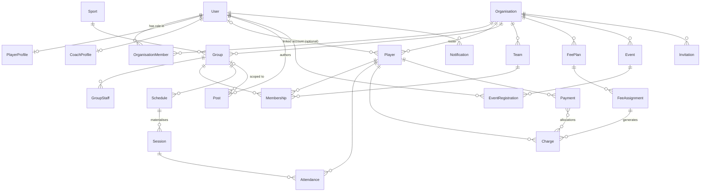

# FitGeng — Architecture Proposal (MVP)

> Status: **APPROVED** (product decisions in §9). Implementation in progress; see `docs/PROGRESS.md`.
> Last updated: 2026-11-09

---

## 1. Guiding decisions

| # | Decision | Rationale |
|---|----------|-----------|
| D1 | **Modular monolith**: one Express API split into feature modules, one React SPA. | Matches spec; simple to deploy on one VPS; modules can split out later if needed. |
| D2 | **TypeScript everywhere**, npm workspaces: `apps/frontend`, `apps/backend`, `packages/shared`. | Shared types and validation across the API boundary. |
| D3 | **Zod schemas in `packages/shared`** are the single source of truth for request validation (backend) and form validation (frontend). Types are inferred from the schemas. | One definition for each rule; frontend and backend can't drift apart. |
| D4 | **The Organisation is the boundary for each tenant's data.** Every group, team, roster player, schedule, session, fee, payment and event belongs to exactly one organisation. A solo coach gets a personal "academy" organisation created automatically. | Gives coaches and organisers one code path. Every management query is filtered by `orgId`, which is the main defence against users reading other organisations' records by guessing IDs (IDOR). |
| D5 | **Two-layer authorisation**: global *capabilities* (player / coach / organiser) control which features a user can reach and what they can create. *Scoped roles* (organisation role, group staff role) control which records they can act on. Checks run in backend policy functions, not only in route middleware. | Covers the requirement that one user can hold any mix of player, coach and organiser. A coach in one group can be a player in another. |
| D6 | **Roster player ≠ user account.** A coach can add a player who has no login (common in academies for children). A roster entry (`Player`) links to a `User` only once the person accepts an invitation or joins themselves. | "Add players manually" only works if the player doesn't need an account first. |
| D7 | **Schedules (recurrence rules) and Sessions (concrete occurrences) are separate collections.** Sessions are created for a rolling window ahead of time. | Required by the spec. Lets each occurrence be edited or cancelled, and gives attendance one stable record to point at. |
| D8 | **Money is stored as integer kobo** (`amountKobo`), currency `NGN`. | Avoids floating-point rounding errors. |
| D9 | **Payments module uses separate obligations (`Charge`) and receipts (`Payment`),** with a `provider` field on each payment (`manual` for now). | Outstanding balance = charges − allocated payments. Paystack or Flutterwave can be added later as another provider without changing the data model. |
| D10 | **MongoDB runs as a single-node replica set**, in dev as well as prod. | Multi-document transactions require a replica set. Needed for approving joins, recording payments and capping event registrations. |
| D11 | **Redis is optional at runtime.** Every Redis call goes through a wrapper that treats failures as cache misses or skips. Auth tokens, email tokens and other state that must persist live in MongoDB (TTL indexes). Redis holds only caches, rate-limit counters and job locks. | Spec: the app must keep working if the cache is down. |
| D12 | **Access token in memory and refresh token in an HttpOnly cookie.** Access JWT lasts 15 minutes and is sent as a Bearer header. The refresh token is opaque, rotated on every use, stored hashed in MongoDB, and reuse of an old one is detected. | Nothing sensitive in `localStorage`. Only the refresh and logout endpoints read the cookie, so CSRF protection is only needed there. |
| D13 | **One origin in production**: Nginx serves the SPA and proxies `/api` to the backend. In dev, Vite proxies `/api` the same way. | Allows `SameSite=Strict` cookies and avoids most CORS complexity. |
| D14 | **Background jobs run in-process** with `node-cron` and a Redis `SET NX` lock (lock skipped if Redis is down and there is a single instance). | Enough for MVP volumes. BullMQ can replace it later without changing services. |
| D15 | **Time zones**: all instants stored in UTC. Recurring times are stored as local wall-clock time plus an IANA zone (`Africa/Lagos` by default) and converted with **Luxon**. | Correct handling even if the platform expands to zones that use daylight saving. |
| D16 | **File uploads** go through a `StorageProvider` interface (`upload`, `delete`, `getUrl`). Production uses the **Cloudinary** driver. A **local** driver (Docker volume) is used in dev and tests when no Cloudinary credentials are set. The backend validates each file (magic bytes, 5 MB limit, image types only), re-encodes it with `sharp` (strips EXIF), then hands it to the provider. Documents store `{ provider, key, url }`, not just a URL, so files can be deleted or migrated later. | Cloudinary from the first deployment (decision Q5). Changing provider means adding one driver file and changing one env var. |
| D17 | **Branding config** (name, colours, logo, support email) lives in `packages/shared/src/brand.ts` with env overrides. Frontend colours are CSS variables that Tailwind consumes. | Rebranding means editing config, not components or business logic. |

---

## 2. Monorepo layout

```text
fitgeng/
├── apps/
│   ├── frontend/                 React + Vite + Tailwind + RTK Query
│   │   └── src/
│   │       ├── app/              store setup, router, providers
│   │       ├── components/       ui/ (Button, Input, Modal, EmptyState…) + shared composites
│   │       ├── contexts/         ThemeContext, BrandingContext (only these)
│   │       ├── features/         auth/, orgs/, players/, groups/, schedules/, attendance/,
│   │       │                     payments/, posts/, events/, discover/, notifications/
│   │       │                     (each: api.ts (RTK Query endpoints), slice?, components/, pages/)
│   │       ├── hooks/            useAuth, usePermissions, useActiveOrg, useDebounce…
│   │       ├── layouts/          PublicLayout, PlayerLayout, ManageLayout
│   │       ├── routes/           route tree, guards (RequireAuth, RequireCapability, RequireOrgRole)
│   │       ├── services/         baseApi (fetchBaseQuery + re-auth mutex), http helpers
│   │       └── utils/            formatting (₦, dates in Africa/Lagos), etc.
│   └── backend/
│       ├── src/
│       │   ├── config/           env (zod-validated), db, redis, logger
│       │   ├── middleware/       authenticate, requireCapability, loadOrgContext, validate,
│       │   │                     rateLimit, errorHandler, notFound, requestId, upload
│       │   ├── modules/<name>/   <name>.model.ts, .service.ts, .controller.ts, .routes.ts,
│       │   │                     .policy.ts (where needed), __tests__/
│       │   ├── services/         cache, email, storage, access (shared policy helpers)
│       │   ├── integrations/     sendgrid/, (paystack/ later)
│       │   ├── jobs/             materializeSessions, generateCharges, markOverdue, scheduler
│       │   ├── emails/templates/ verify-email, reset-password, invitation, join-request, announcement
│       │   ├── utils/            ApiError, asyncHandler, pagination, money, time
│       │   ├── app.ts            express app (no listen) for Supertest
│       │   └── server.ts         connect db/redis, start jobs, listen
│       └── tests/                integration tests, test setup (mongodb-memory-server replset)
├── packages/shared/src/
│   ├── constants/                capabilities, roles, statuses, frequencies, Nigerian states/Lagos areas
│   ├── validation/               zod schemas per module
│   ├── types/                    inferred types + API envelope types
│   └── brand.ts
├── infrastructure/
│   ├── nginx/                    nginx.conf (SPA + /api proxy + /uploads + security headers)
│   └── docker/                   mongo-init (replica set), scripts
├── docker-compose.yml            dev
├── docker-compose.prod.yml       prod
├── .env.example
└── docs/                         ARCHITECTURE.md, API.md (later), PROGRESS.md
```

---

## 3. Identity, capabilities and permissions

### 3.1 Capabilities (global, on `User`)

| Capability | Granted how | Unlocks |
|------------|-------------|---------|
| `player` | Default on signup | Player app: discover, join, my groups/schedule/payments, register for events, post in groups they belong to |
| `coach` | Approved `CapabilityRequest` (platform admin) | Management dashboard; create academy orgs; groups, schedules, sessions, attendance, fees/payments, posts, events |
| `organiser` | Approved `CapabilityRequest` (platform admin) | Management dashboard; create club/community orgs; teams, groups, events & registrations, posts |
| `platformAdmin` (flag) | Seed / DB only | Approve or reject capability requests; revoke capabilities; manage the Sports catalogue; suspend users |

**Getting coach or organiser (decision Q1):** a user applies with a short motivation, the sports they cover, experience and optional links. A platform admin approves or rejects it. Approving adds the capability to `User.capabilities` and emails the user. Rejecting records a reason, and the user can apply again after addressing it. A user can have only one pending request per capability.

Exception: when an organisation owner or admin adds an existing user as an org `coach`, that role works **only inside that organisation**. It gives access to the management dashboard for that organisation but does not grant the global `coach` capability, so the user can't create organisations of their own.

Capabilities are **not exclusive**. They decide what a user *may create* and *which dashboard sections they see*. They never grant access to someone else's records on their own.

### 3.2 Scoped roles

| Scope | Collection | Roles | Can do |
|-------|------------|-------|--------|
| Organisation | `OrganisationMember` | `owner`, `admin`, `coach` | owner/admin: everything in the org. coach: only groups/teams where they are staff, plus read access to the org roster |
| Group / Team | `GroupStaff` | `coach`, `manager` | Manage that group's members, schedules, sessions, attendance, announcements |
| Group / Team | `Membership` | `member`, `captain` | Player-side access: view schedule, announcements, own attendance/payments |

### 3.3 How a request is authorised

```
authenticate            → verifies JWT, loads req.user {id, capabilities, tokenVersion}
requireCapability(...)  → coarse gate for management routes (403 if missing)
loadOrgContext          → for /orgs/:orgId/* — loads OrganisationMember, 404 if not a member
service + policy        → e.g. groupPolicy.canManage(actor, group) — the authoritative check
```

Policies live in each module's `*.policy.ts` and are unit-tested directly. If a policy check fails, records from another organisation return **404, not 403**, so their existence isn't revealed.

---

## 4. Data model

### 4.1 Relationship overview



### 4.2 Collections

Common to all documents: `_id`, `createdAt`, `updatedAt` (Mongoose timestamps). Fields marked **[idx]** are indexed. **[uniq]** marks a unique index.

#### Identity

**User**
- `email` [uniq, lowercased], `passwordHash` (argon2id), `firstName`, `lastName`, `phone?`, `avatarUrl?`
- `capabilities: ('player'|'coach'|'organiser')[]`, `isPlatformAdmin: boolean`
- `emailVerifiedAt?`, `status: 'active'|'suspended'`, `tokenVersion: number` (incremented on password change to invalidate all sessions), `lastLoginAt?`

**PlayerProfile** (1:1, `userId` [uniq])
- `bio?`, `location: LocationRef`, `dateOfBirth?`
- `sports: [{ sportId, skillLevel: 'beginner'|'intermediate'|'advanced'|'pro', yearsExperience?, notes? }]`
- `visibility: 'public'|'members'` (what other players can see)

**CoachProfile** (1:1, `userId` [uniq])
- `slug` [uniq], `headline`, `bio`, `sports: sportId[]`, `certifications: string[]`, `yearsExperience?`, `location`, `isPublic: boolean`

**RefreshToken**
- `userId` [idx], `tokenHash` [uniq], `familyId` [idx], `expiresAt` (TTL), `revokedAt?`, `replacedBy?`, `userAgent?`, `ip?`
- If a revoked token is presented, the whole family is revoked (likely theft).

**EmailToken**
- `userId`, `purpose: 'verify_email'|'reset_password'`, `tokenHash` [uniq], `expiresAt` (TTL index), `usedAt?`

**CapabilityRequest**
- `userId` [idx], `capability: 'coach'|'organiser'`, `motivation`, `sports: sportId[]`, `experience?`, `links?: string[]`
- `status: 'pending'|'approved'|'rejected'|'withdrawn'` [idx (status, createdAt)], `reviewedBy?`, `reviewedAt?`, `reviewNote?`
- **[uniq (userId, capability) partial where status='pending']** allows only one open request per capability.
- Approving runs in a transaction that sets the request to `approved` and adds the capability to the user.

**StoredFile** (embedded value object on documents that hold images): `{ provider: 'cloudinary'|'local', key, url, width?, height? }`

#### Reference data

**Sport**: `name`, `slug` [uniq], `icon?`, `format: 'individual'|'team'|'both'`, `isActive`, `sortOrder`. Seeded with the 7 sports listed in the spec. Platform admins can add more.

**LocationRef** (embedded value object, not a collection): `{ state, city, area?, address?, geo? }`. The list of states and Lagos neighbourhoods ships as a shared constant used for filters. A `2dsphere` index on `geo` is optional; "near me" search is deferred.

#### Organisations and rosters

**Organisation**
- `name`, `slug` [uniq], `type: 'personal'|'academy'|'club'|'community'`, `description?`, `logoUrl?`, `coverUrl?`
- `sports: sportId[]`, `location`, `contactEmail?`, `contactPhone?`, `isPublic`
- `settings: { timezone: 'Africa/Lagos', currency: 'NGN' }`, `ownerId`, `status: 'active'|'archived'`

**OrganisationMember**: `orgId`, `userId`, `role: 'owner'|'admin'|'coach'`, `status`. [uniq (orgId, userId)], [idx userId]

**Player** (the organisation's roster entry)
- `orgId` [idx], `userId?` [uniq (orgId, userId) partial], `firstName`, `lastName`, `email?` [uniq (orgId, email) partial], `phone?`, `avatarUrl?`
- `sports: [{ sportId, skillLevel }]`, `status: 'pending'|'active'|'inactive'|'graduated'`, `joinedAt`, `notes?` (visible to staff only), `addedBy`
- When a user joins or accepts an invitation, the service looks for an existing roster entry matching `(orgId, email)` and links it, rather than creating a duplicate.

**Invitation**
- `orgId`, `target: { kind: 'org'|'group'|'team'|'event', id }`, `email`, `playerId?`, `tokenHash` [uniq], `invitedBy`, `status: 'pending'|'accepted'|'declined'|'revoked'|'expired'`, `expiresAt`

#### Groups, teams and membership

**Group** (training group)
- `orgId` [idx], `name`, `slug`, `description`, `sportId` [idx], `location`, `skillLevel`, `imageUrl?`
- `visibility: 'public'|'approval'|'private'` [idx], `capacity?`, `status: 'active'|'archived'` [idx], `createdBy`
- Compound index for Discover: `(status, visibility, sportId, location.state, location.area)`

**Team** (competitive team): same base fields as Group, plus `season?`, `division?`. It is a separate collection with a separate UI, sharing the membership logic.

**GroupStaff**: `targetType: 'group'|'team'`, `targetId`, `userId`, `role: 'coach'|'manager'`. [uniq (targetType, targetId, userId)], [idx userId]

**Membership**
- `orgId`, `targetType: 'group'|'team'`, `targetId`, `playerId`, `role: 'member'|'captain'`, `position?`, `jerseyNumber?`
- `status: 'requested'|'invited'|'active'|'inactive'|'rejected'|'removed'`, `source: 'self_join'|'request'|'invitation'|'staff_added'`
- `requestedAt?`, `decidedBy?`, `decidedAt?`, `joinedAt?`
- **[uniq (targetType, targetId, playerId)]** prevents duplicate memberships. A rejected or removed membership is reopened by updating its status, not by inserting a new document.
- [idx (playerId, status)] serves "my groups".

Join rules, enforced in `membership.service`:
| Group visibility | Self-join | Request | Invitation | Staff add |
|---|---|---|---|---|
| public | → `active` | n/a | ✓ | ✓ |
| approval | ✗ | → `requested` | ✓ | ✓ |
| private | ✗ | ✗ (404, group hidden) | ✓ | ✓ |

Two statuses exist on purpose. Roster `Player.status` (pending/active/inactive/graduated) is the player's relationship with the **organisation**. `Membership.status` is their place in **one group**.

#### Schedules, sessions and attendance

**Schedule** (recurrence rule)
- `orgId`, `targetType`, `targetId` [idx], `title`, `coachId?`, `location`
- `audience: { kind: 'all_members' } | { kind: 'players', playerIds: [] }`. This covers "Player A Mon/Wed/Fri 7am, Player B Tue/Thu 5pm" inside the same group.
- `recurrence: { daysOfWeek: (0-6)[], startTime: 'HH:mm', durationMinutes, timezone, startDate, endDate? }`
- `status: 'active'|'paused'|'ended'`

**Session** (one occurrence)
- `orgId`, `targetType`, `targetId`, `scheduleId?` (null for one-off sessions), `occurrenceKey?` (`YYYY-MM-DD` local date)
- `startsAt`, `endsAt` (UTC) [idx (targetId, startsAt)], `location`, `coachId?`, `audience` (copied from the schedule at creation time, so the expected attendee list is stable)
- `status: 'scheduled'|'cancelled'|'completed'`, `isModified: boolean`, `cancelReason?`
- **[uniq (scheduleId, occurrenceKey)]** makes session generation idempotent.
- Generation creates sessions up to **8 weeks ahead**. It runs when a schedule is created or updated and nightly by job. When a schedule is edited, future sessions with `isModified=false` and no attendance are regenerated. Sessions edited by hand are left alone.

**Attendance**
- `orgId`, `sessionId`, `playerId`, `targetId`, `status: 'present'|'absent'|'excused'|'late'`, `note?`, `markedBy`, `markedAt`
- **[uniq (sessionId, playerId)]**. Marking attendance is a bulk upsert, so re-marking updates the existing record instead of duplicating it.
- [idx (playerId, markedAt)] and [idx (targetId, markedAt)] serve per-player and per-group summaries (aggregation pipeline).

#### Fees and payments

**FeePlan**: `orgId`, `name`, `amountKobo`, `currency: 'NGN'`, `frequency: 'per_session'|'weekly'|'monthly'|'termly'`, `terms?: [{ label, startDate, endDate, dueDate }]` (required when termly), `dueDayOffset`, `isActive`

**FeeAssignment**: `orgId`, `feePlanId`, `scope: { kind: 'group', groupId } | { kind: 'player', playerId, groupId? }`, `overrideAmountKobo?`, `startDate`, `endDate?`, `status`
- A group-level assignment applies to every active member. A player-level assignment overrides it for that player.

**Charge** (an amount a player owes for one period)
- `orgId`, `playerId` [idx], `groupId?`, `feeAssignmentId`, `period: { start, end, label }`, `amountDueKobo`, `amountPaidKobo`, `dueDate` [idx]
- `status: 'unpaid'|'partial'|'paid'|'waived'`. "Overdue" is computed as `dueDate < now && status ∈ {unpaid, partial}`, not stored.
- **[uniq (feeAssignmentId, playerId, period.start)]** makes charge generation idempotent.
- Weekly, monthly and termly charges are generated by a daily job. Per-session charges are created when attendance is marked `present` (see open question Q3).

**Payment** (money received)
- `orgId`, `playerId` [idx], `groupId?`, `amountKobo`, `paidAt`, `period: { start, end, label }`, `method: 'cash'|'bank_transfer'|'pos'|'other'`, `reference?`
- `allocations: [{ chargeId, amountKobo }]`, `status: 'recorded'|'voided'`, `recordedBy`, `voidedBy?`, `voidReason?`
- `provider: 'manual'` plus `providerRef?`, `providerPayload?`, reserved for a future gateway.
- Recording or voiding a payment runs in a **transaction** that updates `Charge.amountPaidKobo` and `status`. The service checks that `playerId` and `groupId` on the payment match every allocated charge and the same `orgId`.

#### Community

**Post**
- `authorId`, `orgId?`, `targetType?`, `targetId?`, `type: 'general'|'training'|'recruitment'|'event'|'achievement'`, `body`, `images: string[]` (max 4)
- `visibility: 'public'|'org'|'group'` [idx (visibility, createdAt)], `cta?: { kind: 'view_group'|'join_group'|'view_coach'|'register_event', targetId }`, `status: 'published'|'removed'`
- Privacy rule: the public feed returns `visibility='public'` only. Creating a public post scoped to a private group is rejected. Group announcements are visible only to active members and staff.
- Who can post: any user can post `general` or `achievement` posts publicly. Group staff can post in their groups. Active members can post in groups that allow member posts. Recruitment and event posts need coach or organiser capability plus the matching org role.

**Event**
- `orgId`, `createdBy`, `title`, `type: 'friendly_match'|'training'|'meetup'|'community_game'|'tournament'`, `sportId`, `description`, `location`, `startsAt`, `endsAt`, `imageUrl?`
- `capacity?`, `registeredCount` (denormalised counter), `visibility: 'public'|'invite_only'`, `registrationDeadline?`, `allowCancellation: boolean`
- `status: 'draft'|'published'|'cancelled'|'completed'` [idx (status, visibility, startsAt)]

**EventRegistration**: `eventId`, `userId`, `status: 'registered'|'cancelled'|'invited'`, `registeredAt`, `cancelledAt?`. **[uniq (eventId, userId)]**
- The capacity limit is enforced atomically: `Event.updateOne({ _id, registeredCount: { $lt: capacity } }, { $inc: { registeredCount: 1 } })`, inside the same transaction as the registration upsert.

**Notification**: `userId` [idx (userId, readAt, createdAt)], `type`, `title`, `body`, `link?`, `data?`, `readAt?`. In-app list. Some types also send an email.

**Activity** (feeds the "recent activities" dashboard widget): `orgId` [idx (orgId, createdAt)], `actorId`, `verb`, `subject: { kind, id, label }`. TTL index of 90 days.

---

## 5. API design

- Base path `/api/v1`. JSON only, except multipart upload endpoints.
- **Success response:** `{ "data": ..., "meta"?: { "page", "limit", "total", "totalPages" } }`
- **Error response:** `{ "error": { "code": "VALIDATION_ERROR", "message": "...", "details"?: [...] , "requestId": "..." } }`
- Pagination `?page=&limit=` (limit ≤ 100), sorting `?sort=-createdAt,name` (each module has an allow-list of sortable fields), filters as query params validated by zod.
- Mass-assignment protection: controllers pass only `schema.parse(req.body)` output to services. Zod objects are `.strict()`. Protected fields (`orgId`, `capabilities`, `status`, `recordedBy`…) are never taken from the body.

### Route map (summary)

```
Public / player
  POST   /auth/register | /auth/login | /auth/refresh | /auth/logout
  POST   /auth/verify-email | /auth/resend-verification | /auth/forgot-password | /auth/reset-password
  GET    /me                       PATCH /me
  GET    /me/capability-requests   POST /me/capability-requests   POST /me/capability-requests/:id/withdraw
  GET    /me/profile/player        PUT   /me/profile/player
  GET    /me/profile/coach         PUT   /me/profile/coach
  GET    /me/memberships | /me/sessions | /me/attendance | /me/charges | /me/payments | /me/orgs
  GET    /sports
  GET    /discover/groups | /discover/coaches | /discover/orgs | /discover/teams | /discover/events
  GET    /groups/:slugOrId (public view)     POST /groups/:id/join     DELETE /groups/:id/membership
  GET    /coaches/:slug   GET /orgs/:slug (public)
  POST   /invitations/:token/accept | /decline
  GET    /feed                     POST /posts            GET /posts/:id
  GET    /events/:id               POST /events/:id/registrations   DELETE /events/:id/registrations/me
  GET    /notifications            PATCH /notifications/:id/read    POST /notifications/read-all
  POST   /uploads (images)

Management (all scoped by organisation)
  POST   /orgs                     GET/PATCH /orgs/:orgId          /orgs/:orgId/members
  GET    /orgs/:orgId/dashboard
  CRUD   /orgs/:orgId/players      POST /orgs/:orgId/players/invite
  CRUD   /orgs/:orgId/groups       /orgs/:orgId/groups/:id/staff
         /orgs/:orgId/groups/:id/members   (add, remove, approve, reject, change status)
  CRUD   /orgs/:orgId/teams        (+ members, staff)
  CRUD   /orgs/:orgId/schedules
  CRUD   /orgs/:orgId/sessions     POST /orgs/:orgId/sessions/:id/cancel
  GET/PUT /orgs/:orgId/sessions/:id/attendance     GET /orgs/:orgId/attendance/summary
  CRUD   /orgs/:orgId/fee-plans    /orgs/:orgId/fee-assignments
  GET    /orgs/:orgId/charges      (?status=overdue)
  POST   /orgs/:orgId/payments     GET  /orgs/:orgId/payments   POST /orgs/:orgId/payments/:id/void
  CRUD   /orgs/:orgId/events       GET  /orgs/:orgId/events/:id/registrations   POST .../invite
  CRUD   /orgs/:orgId/posts

Platform admin
  GET    /admin/capability-requests (?status=pending)
  POST   /admin/capability-requests/:id/approve | /reject
  DELETE /admin/users/:id/capabilities/:capability     PATCH /admin/users/:id/status
  CRUD   /admin/sports
```

---

## 6. Cross-cutting concerns

### 6.1 Security
- **Passwords:** argon2id. Password rules defined in a shared zod schema. Login rate-limited per IP and per email.
- **JWT:** access token signed HS256 with a 15-minute expiry. Claims are `sub`, `tv` (tokenVersion) and `caps`. Capabilities are re-read from the database for sensitive operations, so revoking a capability takes effect immediately.
- **Refresh:** opaque random token in a cookie `HttpOnly; Secure; SameSite=Strict; Path=/api/v1/auth`. Rotated on every use, with reuse detection.
- **CSRF:** only `/auth/refresh` and `/auth/logout` read the cookie. They also require the header `X-Requested-With: fitgeng` and check `Origin` against an allow-list. All other endpoints use Bearer tokens, which browsers don't attach automatically, so CSRF doesn't apply to them.
- **Other protections:** `helmet`, strict CORS allow-list from env, `express-mongo-sanitize`-style key stripping, 100 kb JSON body limit, and rate limiting (Redis store, falling back to an in-memory store).
- **Errors:** an `ApiError` class plus a central handler. Stack traces never leave the server in production. Every response carries a `requestId` header.
- **Logging:** `pino` + `pino-http` with secrets, cookies and auth headers redacted.

### 6.2 Redis usage (`services/cache`)
- `cache.wrap(key, ttl, loader)` does cache-aside. On any Redis error it logs once (throttled) and calls the loader directly.
- Invalidation uses **namespace version keys**: e.g. `ns:groups:public` holds a version number that is part of every cached key. A write increments it, which invalidates all related pages without scanning keys.
- Cached data: sports list (24h), public group/coach/event listings (5 min), public coach profiles (10 min), dashboard summaries per org (60 s).
- Also used for rate-limit counters and job locks.

### 6.3 Email (`services/email` + `integrations/sendgrid`)
- `EmailService.send(templateId, to, data)` renders HTML and text templates kept in `emails/templates`, using the brand config. The provider is chosen by env: `sendgrid` in prod, `log` in dev and tests (prints a link instead of sending). Local dev therefore needs no SendGrid key.
- Sending is non-blocking with retry. A failed email never fails the business transaction. Verification and reset emails can be re-requested.

### 6.4 Frontend state
- **RTK Query** handles all server state, with tag-based invalidation (`Group`, `Membership`, `Session`, …). The base query includes a re-auth mutex: on a 401 it calls `/auth/refresh` once, then retries the original request.
- **Redux slices:** `auth` (access token, current user, capabilities) and `ui` (active org ID, persisted to localStorage). No other global state.
- **Context:** `ThemeContext` (light/dark) and `BrandingContext` (brand config). Nothing is stored in both Redux and Context.
- Route guards: `RequireAuth`, `RequireCapability`, `RequireOrgRole`. These only control what the UI shows; the backend still enforces every rule.
- Layouts: **PublicLayout** (marketing header), **PlayerLayout** (bottom tab bar on mobile, top nav on desktop), **ManageLayout** (collapsible sidebar plus org switcher). Users with both hats switch modes from the avatar menu.
- Every data view uses a shared pattern for loading, error and empty states (`<QueryState>` component).

### 6.5 Testing strategy
- **Backend:** Jest + ts-jest + Supertest against `mongodb-memory-server` running as a replica set (so transactions work). Redis is mocked as unavailable by default, which also tests the fallback path, and is enabled in specific cache tests. Policy and service unit tests sit next to the code. Integration tests go in `tests/`.
- **Frontend:** Jest + React Testing Library + MSW, used to mock HTTP in tests only, never in the running app.
- **Critical business-rule tests**, required before each phase is marked done:
  1. A user from organisation A gets 404 on organisation B's players, groups, payments and sessions.
  2. Self-joining a private group fails. Self-joining an approval group creates a `requested` membership. Accepting an invitation works.
  3. Concurrent duplicate joins result in one membership (unique index plus handling of duplicate-key errors).
  4. Marking the same player twice for one session leaves one attendance record.
  5. An org coach cannot manage a group where they are not staff. An org admin can.
  6. A payment allocated to another player's or another organisation's charge is rejected. Charge totals stay consistent after recording and after voiding.
  7. Event registration never exceeds capacity under concurrent requests.

### 6.6 Docker
- **Dev (`docker-compose.yml`):** `mongo` (replica set initialised by a healthcheck script, named volume), `redis`, `backend` (`tsx watch`, source bind-mounted), `frontend` (Vite dev server, bind mount). `depends_on` waits for the health checks. Ports are exposed for local tools.
- **Prod (`docker-compose.prod.yml`):** multi-stage builds. Backend runs compiled JS as a non-root user. The frontend is built into an **nginx** image that serves the SPA, proxies `/api` and serves `/uploads`. Mongo and Redis are only reachable on the internal network. Secrets come from `.env` or the host environment, never from images.

---

## 7. Implementation sequence

Each phase ends with passing tests, an updated `docs/PROGRESS.md`, and a short review checkpoint with you.

| Phase | Scope | Key deliverables / tests |
|-------|-------|--------------------------|
| **1. Foundation** | Workspaces, TS configs, ESLint/Prettier, shared package, Express skeleton (env validation, logger, error handler, response helpers, health endpoint), Mongo replica-set connection, Redis wrapper with fallback, Vite + Tailwind + Router + RTK store + layouts shell, brand config, Docker dev compose, Jest in both apps | `GET /api/v1/health` reports db/redis status; app boots with Redis stopped; frontend renders the shell; CI-ready `npm test` |
| **2. Auth & permissions** | User, profiles, refresh tokens, email tokens, register/login/refresh/logout, verify email, forgot/reset password, capability requests + admin approval (API + minimal admin page), `authenticate`/`requireCapability`, policy helpers, Sports catalogue + seed (incl. admin user seed), frontend auth pages, re-auth base query, guards, profile pages | Auth flow integration tests; token reuse detection; only admins can approve; approval grants capability; frontend auth-flow and guard tests |
| **3a. Orgs, roster, groups, teams, memberships** | Organisations + members, Player roster, invitations (email), groups, teams, staff, membership state machine, uploads (StorageProvider: Cloudinary + local drivers) | Cross-org isolation, join rules, duplicate prevention, staff scoping, upload validation |
| **3b. Schedules, sessions, attendance** | Schedule CRUD, session materialisation job + Luxon, one-off sessions, cancel/edit, attendance bulk upsert, summaries | Idempotent generation, timezone correctness, per-player schedules, duplicate attendance |
| **3c. Fees & payments** | Fee plans, assignments, charge generation job, manual payments with allocations (transactional), void, outstanding/overdue views, dashboard overview endpoint (cached) | Payment/charge integrity, cross-player rejection |
| **4. Player experience** | Player home, Discover (filters + caching), public group/coach/org pages, join/request flows, My Groups, My Schedule, My Payments, attendance history | Discover filters, privacy of private groups, UI interaction tests |
| **5. Community** | Posts + feed + group announcements + CTAs, events + registrations + invitations, notifications (in-app + email triggers), activity log | Feed privacy, capacity under concurrency, notification triggers |
| **6. Hardening & deploy prep** | Security review pass, permission audit, prod compose + nginx, API docs (OpenAPI generated from zod via `zod-to-openapi`), README setup, seed script with demo data | Prod compose build runs end-to-end |

---

## 8. Explicitly deferred / simplified (not silently skipped)

- **Payment gateway** (Paystack/Flutterwave): the data model is ready (`provider`, `providerRef`). No integration in the MVP.
- **Admin console**: the MVP includes only the pages needed to review capability requests and manage sports. A full back office (user search, moderation queues, analytics) is deferred.
- **Parent/guardian accounts** for minors: roster players without accounts cover the basic need.
- **SMS / WhatsApp / push notifications**: in-app and email only. WhatsApp is worth prioritising after the MVP for the Nigerian market.
- **Geo "near me" search**: filters use state and area only.
- **Real-time updates** (websockets), direct messaging, comments and likes on posts, algorithmic feed.
- **Tournament brackets, leagues, rankings, fixture generation** (per spec).
- **Job queue** (BullMQ): in-process cron with a Redis lock.
- **Internationalisation / multi-currency**: NGN and English only.

---

## 9. Resolved product decisions (2026-11-09)

| # | Question | Decision |
|---|----------|----------|
| Q1 | How do users become coaches or organisers? | **Platform admin approval** through `CapabilityRequest` (§3.1). |
| Q2 | Can coaches keep players who never sign up? | **Yes.** `Player.userId` is optional (D6). |
| Q3 | Which sessions do per-session fees charge for? | **Attended sessions only.** A charge is created when attendance is marked `present` (or `late`). If attendance changes away from present, the charge is removed or voided, provided nothing has been paid against it. |
| Q4 | Roster status after self-joining a public group? | **`active`.** |
| Q5 | File storage in production? | **Cloudinary from the first deployment**, behind a replaceable `StorageProvider` (D16). |
